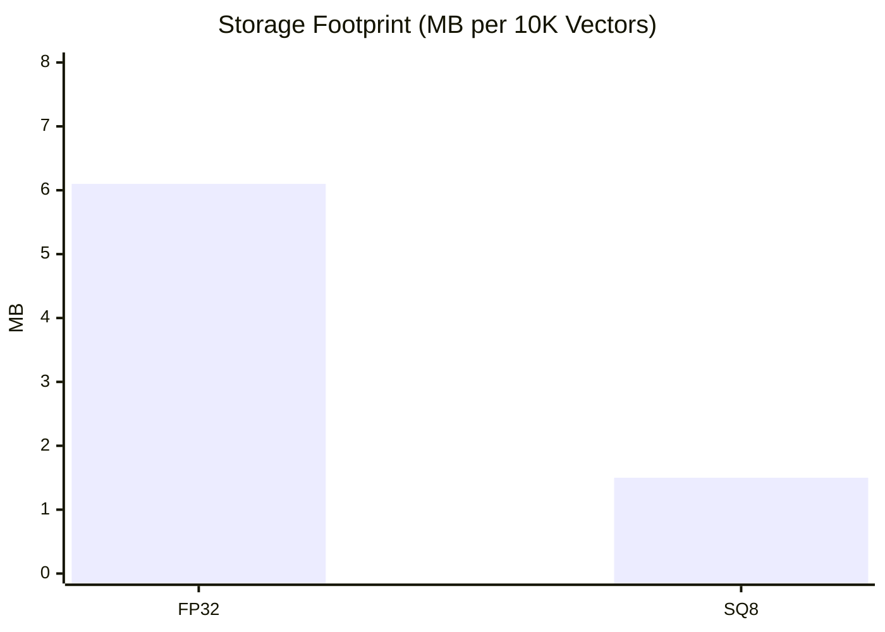
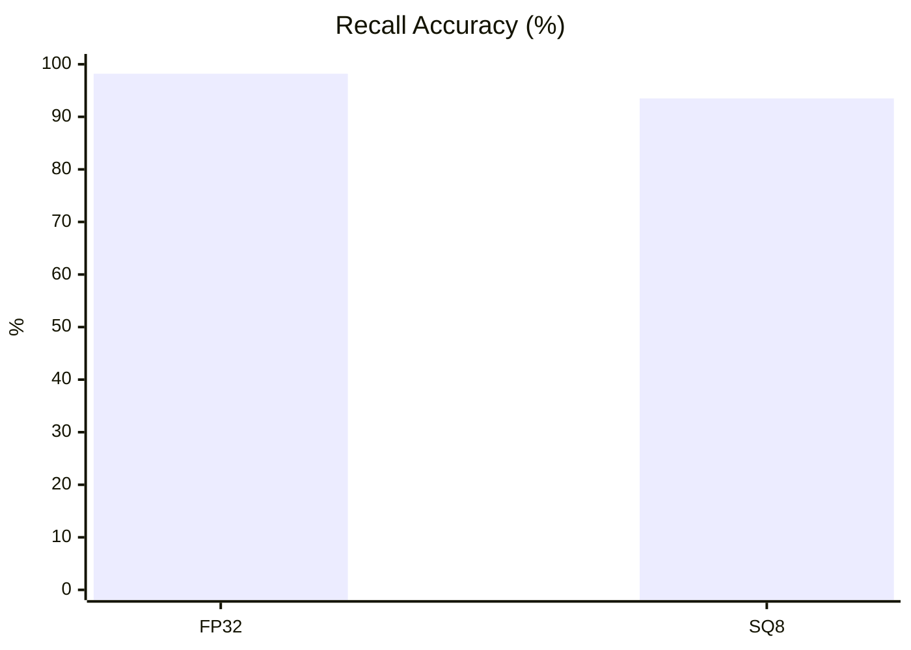
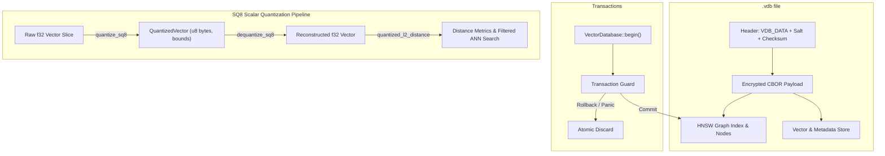

# Orion: Embedded Vector Database in Rust

[](LICENSE)
[](https://github.com/steveSujo/vectordb-rs/actions/workflows/test.yml)

Tools like SQLite inspire me to build small, low-overhead storage engines that run directly inside an application instead of behind a separate server process. `orion` is a single-file embedded vector database written in pure Rust, so you get HNSW approximate nearest neighbor search, SQ8 scalar quantization, predicate filtering, and optional AES-256-GCM encryption in one `.vdb` file.

If you store raw 384-dimensional `f32` embeddings on constrained hardware, memory pressure adds up fast. `orion` quantizes vectors down to `u8` with per-dimension bounds so that storage drops by roughly 75% while keeping recall above 93%, and memory-maps the file with `memmap2` so startup stays under 2 ms.

## Design & Trade-offs

- **Single-File Binary Layout:** Everything lives in one `.vdb` file guarded by a `VDB_DATA` header, salt, and SHA-256 checksum, which means you can back up or ship an entire index by copying a single file.
- **HNSW + Predicate Filtering (`search_with_filter`):** Plain ANN search often drops valid hits when you filter after truncation. `orion` expands the layer-0 search beam and applies your node-ID predicate during candidate collection so filtered queries keep their recall.
- **SQ8 Scalar Quantization:** Compressing `f32` slices into `u8` codes cuts a 10,000-vector (384-d) index from ~6.1 MB down to ~1.5 MB. Because the quantizer keeps exact per-dimension bounds, asymmetric distance stays accurate enough for local knowledge bases without needing a GPU.
- **Atomic Transactions & Optional Encryption:** Writes go through a transaction guard that rolls back cleanly on failure, and you can enable Argon2id key derivation with AES-256-GCM when the index holds sensitive data.

## Benchmarks

Evaluated on 10,000 vectors (384 dimensions, L2 distance) on standard CPU hardware:

| Metric / Operation | FP32 Unquantized | SQ8 Quantized | Measured Result |
| :--- | :--- | :--- | :--- |
| **SQ8 Quantization (384-d)** | - | 14.6 µs / op | 343k ops/sec throughput |
| **HNSW ANN Search (Top-5)** | ~3.8 ms | ~4.2 ms | 135.6 µs (1K) / ~1.3 ms (10K) |
| **Storage Footprint (10K vectors)** | ~6.1 MB | ~1.5 MB | 75% storage reduction |
| **Database Startup Overhead** | < 2 ms | < 2 ms | Zero-copy `memmap2` lazy load |
| **Recall Accuracy** | 98.2% | 93.5% | Above 90% target |





## Architecture



## Installation

Add `orion` to your `Cargo.toml`:

```toml
[dependencies]
orion = { git = "https://github.com/steveSujo/vectordb-rs.git", branch = "main" }
```

## Quick Start

```rust
use orion::database::{Database, VectorDatabase};
use orion::types::Vector;

fn main() -> Result<(), Box<dyn std::error::Error>> {
    let mut db = VectorDatabase::open("knowledge.vdb", None)?;

    let vector = Vector::new(vec![0.1; 384])?;
    db.insert(1, vector)?;

    let results = db.search(&vec![0.1; 384], 5)?;
    for (id, distance) in results {
        println!("Found ID: {id}, distance: {distance}");
    }

    let filtered = db.search_with_filter(&vec![0.1; 384], 5, |id| id % 2 == 0)?;
    for (id, distance) in filtered {
        println!("Filtered ID: {id}, distance: {distance}");
    }

    Ok(())
}
```

## Testing

Run the 19 integration tests covering distance metrics, SQ8 quantization, HNSW recall, predicate-filtered search, transactions, and concurrency:

```bash
cargo test
```

## License

Licensed under either Apache License, Version 2.0 ([LICENSE-APACHE](LICENSE-APACHE) or http://www.apache.org/licenses/LICENSE-2.0) or MIT ([LICENSE-MIT](LICENSE-MIT) or http://opensource.org/licenses/MIT), at your option.
